# Daniel Rizzo · estudo de caso

**Site e blog para um psicólogo clínico que atende online.**
Projeto para cliente real, do briefing à publicação.

`Cliente real` · `Site institucional + blog` · `WordPress + React` · `2026`

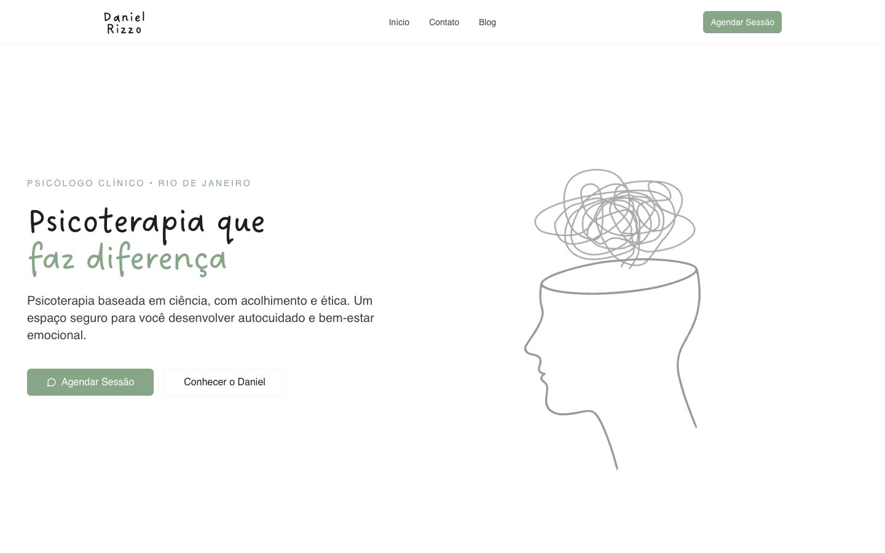

> Daniel Rizzo é psicólogo clínico (CRP 05/73924) no Rio de Janeiro e atende
> por psicoterapia online, com TCC e Terapias Contextuais. O site está no ar em
> [psidanielrizzo.com.br](https://psidanielrizzo.com.br/). Este repositório
> mostra o resultado e o raciocínio do projeto; **o código-fonte fica em um
> repositório privado.**

---

## O desafio

**Um psicólogo que trata ansiedade não podia ter um site que causasse
ansiedade.**

Quem procura terapia costuma chegar inseguro, sem saber se "o problema é sério
o bastante", com medo de se expor e sem entender como funciona uma sessão. O
site precisava:

- acolher sem soar vago, e explicar sem soar técnico;
- passar a seriedade da abordagem baseada em evidências;
- responder as dúvidas práticas (duração, plataforma, sigilo, pagamento,
  cancelamento) antes da primeira mensagem;
- tornar o primeiro contato o mais leve possível: um clique no WhatsApp;
- dar ao Daniel um **blog próprio**, que ele mesmo atualiza.

---

## Direção visual

**Calmo, humano e com personalidade.** Quase tudo é preto no branco, com muito
respiro entre as seções. A personalidade vem de **traços rabiscados à mão**: a
ilustração do hero, uma cabeça com um rabisco embolado no lugar dos
pensamentos, e um fio fino, como de caneta, que atravessa a página.

| Cor | Papel no site |
|---|---|
| Branco `#FFFFFF` | fundo principal |
| Cinza quase branco `#F7F7F7` | seções alternadas e cards |
| Quase preto `#1F1F1F` | títulos |
| Verde sálvia `#87A688` | destaques, sobretítulos e botões |

**Tipografia:** os títulos usam **Dreaming Outloud**, uma letra manuscrita que
conversa com os traços das ilustrações. O texto corrido fica numa fonte sem
serifa simples, para a leitura não cansar.

---

## Home

### Hero
A promessa em uma linha, "Psicoterapia que *faz diferença*", com o destaque em
verde. Ao lado, a ilustração do rabisco: a ansiedade desenhada sem drama. Duas
saídas: agendar a sessão ou conhecer o Daniel primeiro.

### Como posso te ajudar?
Seis áreas de foco escritas do ponto de vista de quem procura ajuda, e não em
termos clínicos: *regulação emocional*, *flexibilidade diante do medo*,
*clareza de valores*.

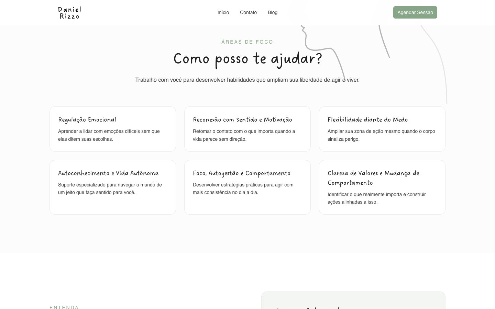

### O que acontece na terapia?
Desfaz a ideia de que terapia "é só falar". Ao lado do texto, um quadro com o
que a pessoa desenvolve no processo.

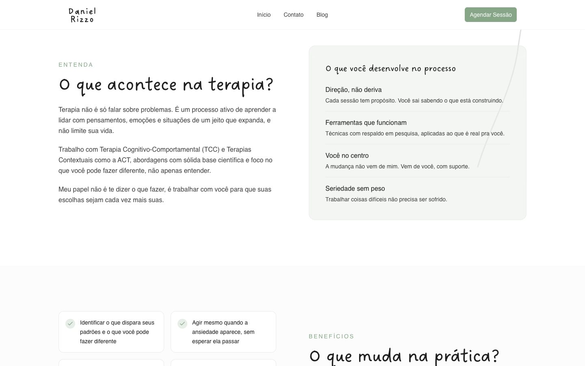

### O que muda na prática?
Mudanças concretas, em frases curtas: *"Tomar decisões a partir dos seus
valores, não do medo"*.

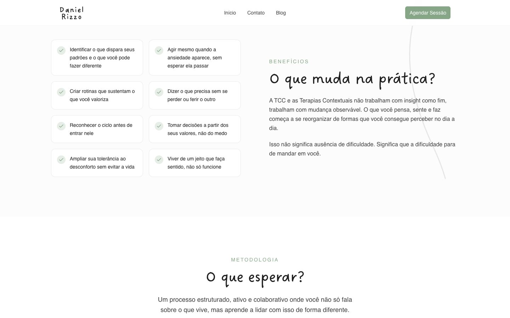

### O que esperar?
A metodologia resumida numa ideia só: *uma terapia que trabalha com você, não
por você*.

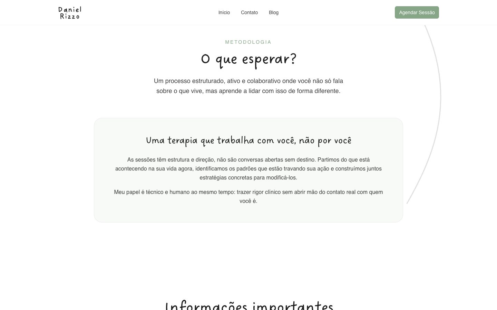

### Informações importantes
As dúvidas práticas respondidas antes de alguém precisar perguntar: sessões de
50 minutos, atendimento por plataformas criptografadas, sigilo profissional e
reagendamento sem custo com 24 horas de antecedência.

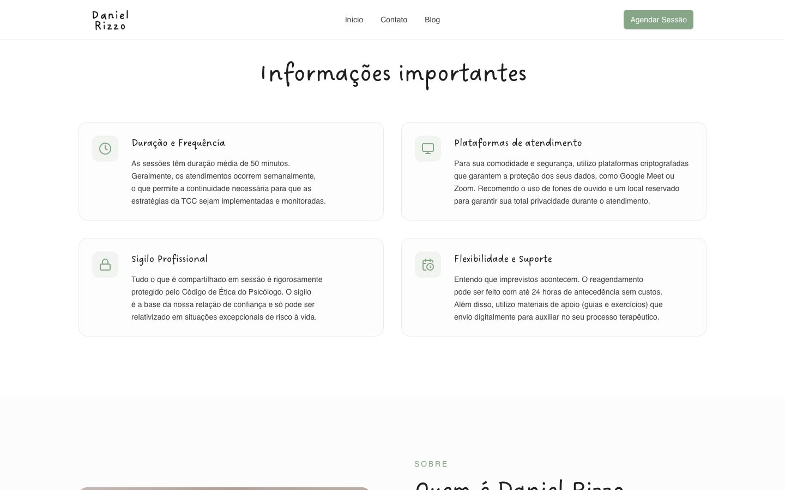

### Quem é Daniel Rizzo
Foto real, texto em primeira pessoa e o "como eu trabalho" em três pontos, com
o registro no CRP no fim.

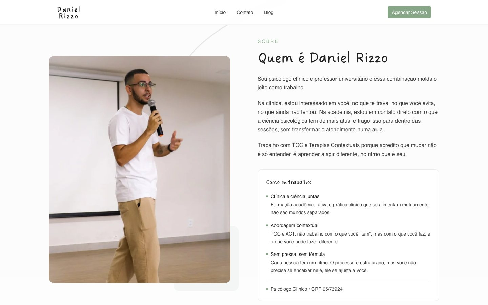

### Dúvidas frequentes
Começa pela pergunta que mais trava quem pensa em fazer terapia: *"Preciso ter
algo sério para buscar terapia?"*

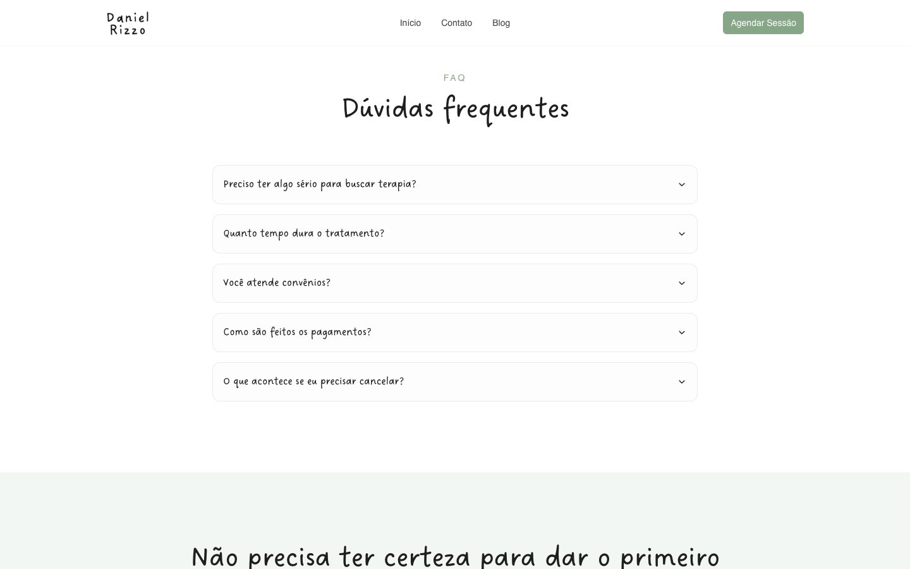

### Primeiro passo e contato
Antes do contato, uma seção curta tira o peso da decisão: *"Não precisa ter
certeza para dar o primeiro passo"*. Depois, o WhatsApp vem primeiro, sem
formulário e sem etapas, e só então e-mail, Instagram e atendimento.

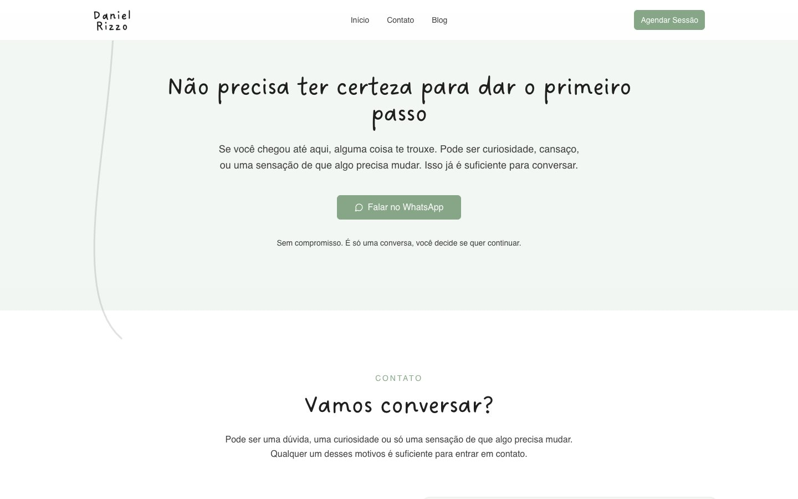

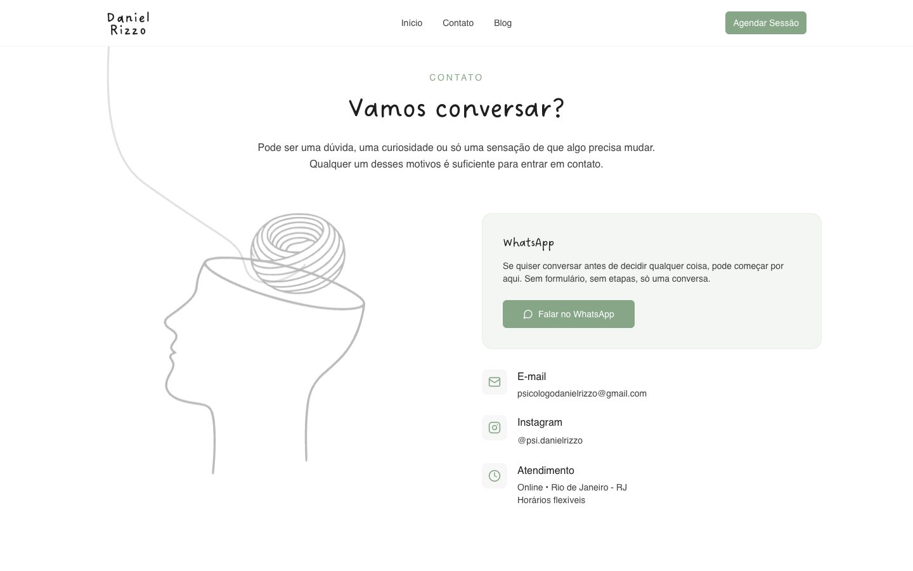

O rodapé traz o CRP e um aviso de responsabilidade: em crise fora do horário
de atendimento, ligar para o **CVV (188)** ou procurar a emergência mais
próxima.

---

## Blog

Um espaço para o Daniel publicar conteúdo educativo de psicologia baseada em
evidências. Os títulos manuscritos, que dão personalidade à home, também
organizam a lista de artigos. Ele publica direto pelo painel do WordPress, sem
depender de desenvolvedor.

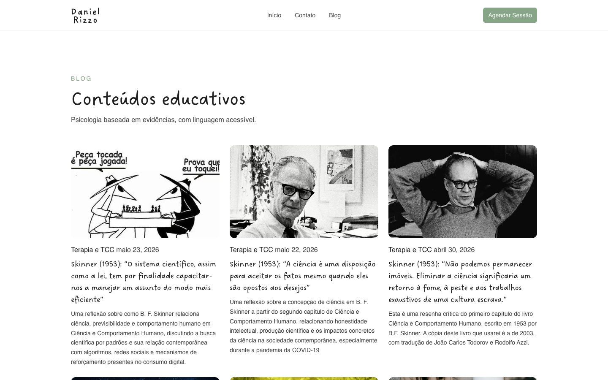

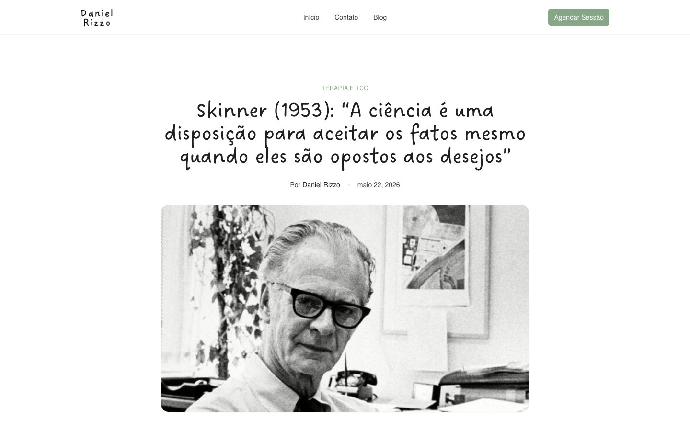

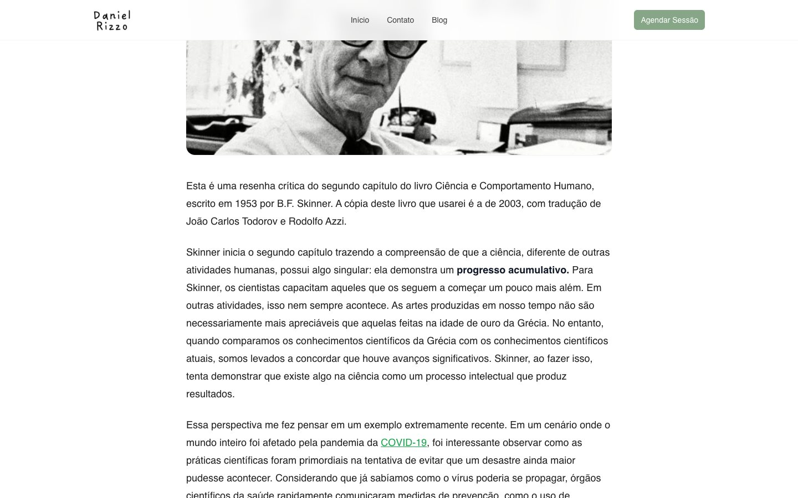

---

## Páginas legais

Política de Privacidade e Termos de Uso em linguagem direta. A política
descreve o que o site faz de verdade: não usa cookies de rastreamento e o único
contato é pelo WhatsApp.

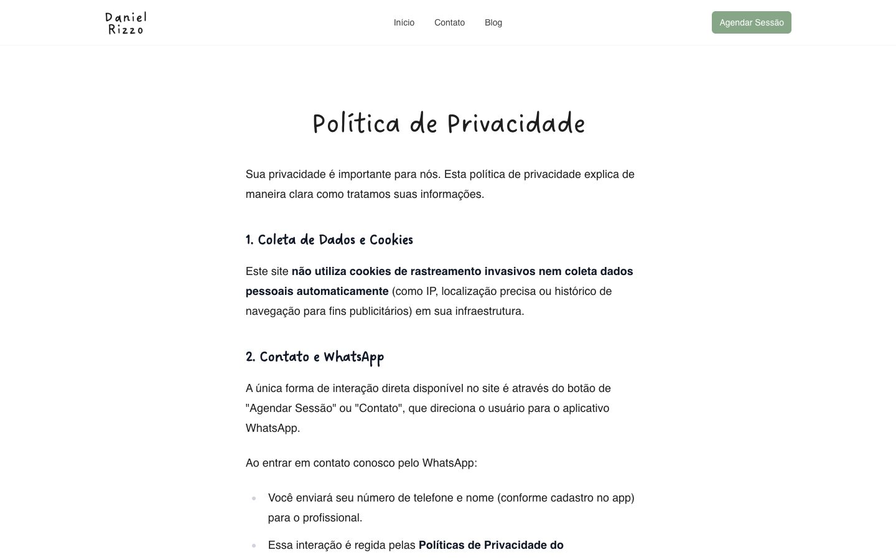

---

## No celular

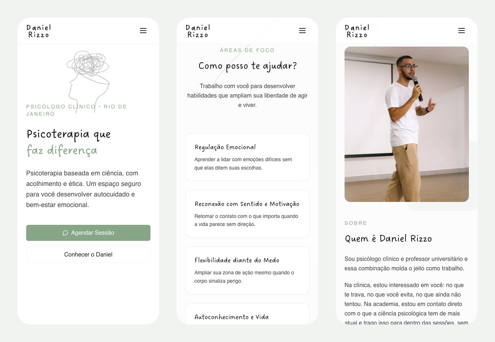

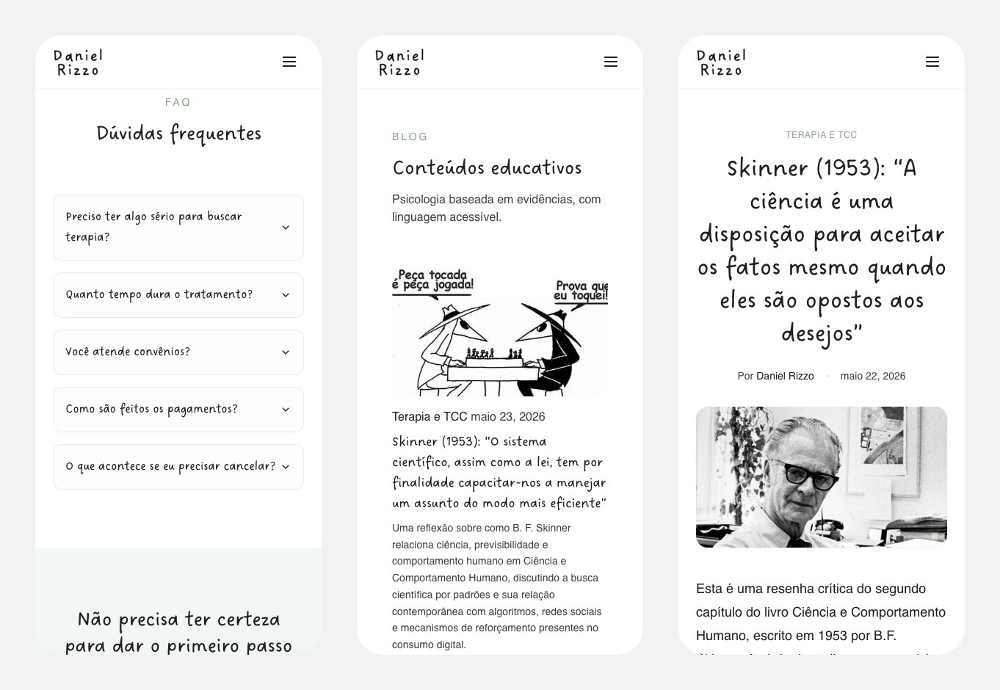

---

## Decisões que fizeram diferença

**Acolhimento**
- Texto em segunda pessoa, respondendo o medo antes da dúvida técnica.
- Ilustrações à mão no lugar de banco de imagens de "pessoa triste na janela".
- Nenhuma promessa de cura ou de resultado.

**Conversão**
- Um caminho principal, "Agendar Sessão", presente no menu e no hero.
- Primeiro contato pelo WhatsApp, sem formulário.
- Dúvidas práticas e FAQ resolvidas na própria página.

**Responsabilidade e ética**
- Registro no CRP visível na apresentação e no rodapé.
- Aviso do CVV (188) para situações de crise.
- Sigilo e uso de plataformas criptografadas explicados com clareza.

**Autonomia do cliente**
- Tema WordPress feito sob medida, com o blog gerenciado pelo painel: o Daniel
  publica sozinho.

---

## Ficha técnica

| | |
|---|---|
| **Cliente** | Daniel Rizzo, psicólogo clínico (Rio de Janeiro) |
| **Páginas** | Home, Blog, artigos, Política de Privacidade, Termos de Uso |
| **Front-end** | React compilado com Vite, dentro de um tema WordPress próprio |
| **Conteúdo** | WordPress (blog e páginas) |
| **Fontes** | Dreaming Outloud nos títulos |
| **Hospedagem** | Hostinger |
| **Site** | [psidanielrizzo.com.br](https://psidanielrizzo.com.br/) |
| **Código** | repositório privado |

---

Projeto desenvolvido pela [DevCraft](https://devcraft.dev.br).
